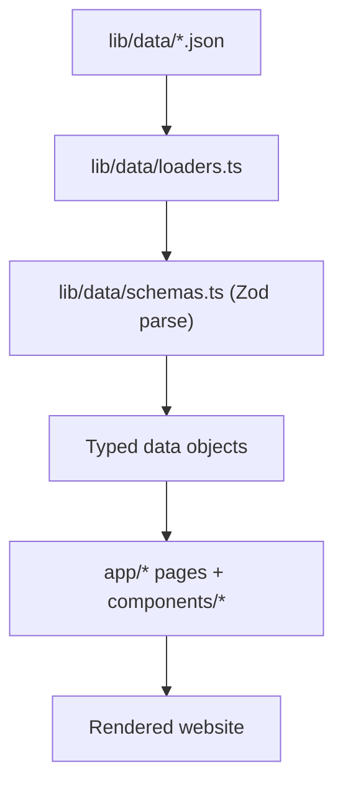

# Desktop Dashboard (Portfolio) — Agent Guide

This document is a **spec + implementation guide** for building a **desktop dashboard app** that edits the portfolio website by **modifying JSON files in `lib/data/`**, and optionally uses **Git** to commit and push changes.

It’s written for an “Agent” that will implement the desktop app.

---

## What this website is (quick mental model)

This repo is a Next.js app. The site content is **not hardcoded in components** anymore; it is read from JSON files under `lib/data/`, validated with Zod at load time, and rendered by React components.

### Content data flow (source of truth)



- **Content**: `lib/data/*.json`
- **Runtime validation**: `lib/data/schemas.ts`
- **Validated imports**: `lib/data/loaders.ts`
- **UI strings only**: `lib/i18n/en.json`, `lib/i18n/fr.json`

---

## Where to edit content (JSON inventory)

All files live in `lib/data/`.

### Navigation
- **Nav pages**: `navigation.json`
  - Schema: `NavigationSchema` (`href`, `i18nKey`)
- **Social links**: `social-links.json`
  - Schema: `SocialLinksSchema` (`id`, `i18nKey`, `icon`, `defaultUrl`, `envVar?`)

### Homepage
- **Tech stack tiles**: `tech-stack.json`
  - Schema: `TechStackSchema` (`name`, `icon`, `gradient`)
- **Testimonials content**: `testimonials.json`
  - Schema: `TestimonialsSchema`

### Projects
- **All projects**: `projects.json`
  - Schema: `ProjectsSchema`
  - Contains localized fields like `title.en`, `title.fr`, etc.
- **Projects category filter list**: `project-categories.json`
  - Schema: `ProjectCategoriesSchema`

### About
- **Skills list**: `skills.json`
  - Schema: `SkillsSchema`
- **Experiences / timeline**: `experiences.json`
  - Schema: `ExperiencesSchema`

### Contact
- **Contact info defaults**: `contact.json`
  - Schema: `ContactSchema`
  - Note: website code uses env overrides if present (see below).

---

## Localization rules (how the website chooses EN/FR)

### UI labels/buttons
UI strings use the i18n dictionaries:
- `lib/i18n/en.json`
- `lib/i18n/fr.json`

The runtime i18n provider is in `lib/i18n/index.tsx`.
- It stores the selected locale in `localStorage` under key `locale`.
- It updates `<html lang="...">`.
- `useI18n()` exposes:
  - `locale` (`"en"` or `"fr"`)
  - `t("some.key")` for UI strings
  - `setLocale(locale)`

### Content (projects, testimonials, experiences)
Content is localized in `lib/data/*.json` using:

```json
{ "en": "English text", "fr": "Texte français" }
```

Components render localized content by selecting `field[locale]`.

### Dashboard configuration page requirement
Your dashboard app must let the user **locate this codebase folder** (repo root) and then operate relative to it.

Minimum settings to store:
- **Repo root path** (must contain `package.json`, `app/`, `lib/`)
- **Preferred locale to edit**: `en` or `fr`
- Optional: default branch name, remote name (usually `origin`)

Recommended: store settings in the desktop app (e.g. local config file), not in the website repo.

---

## Env overrides (important for the dashboard)

Some website values can be overridden by environment variables.

In `lib/data/social-links.json`, each link can specify `envVar` such as:
- `NEXT_PUBLIC_GITHUB_URL`
- `NEXT_PUBLIC_LINKEDIN_URL`
- `NEXT_PUBLIC_TWITTER_URL`

In `lib/data/contact.json`, each item can specify `envVar` such as:
- `NEXT_PUBLIC_CONTACT_EMAIL`
- `NEXT_PUBLIC_CONTACT_PHONE`
- `NEXT_PUBLIC_LOCATION`

The website renders:
- `envVar` value if present, else `defaultValue` or `defaultUrl`.

Dashboard UX suggestion:
- Show both:
  - “Default (JSON)” value
  - “Effective value” if an env var is detected (optional: by reading `.env.local` if present)

---

## Desktop app responsibilities (functional spec)

### 1) Repository selection & validation
When user selects a folder:
- Validate it is the repo root:
  - `package.json` exists
  - `lib/data/` exists
  - `lib/data/loaders.ts` exists
  - `lib/data/schemas.ts` exists
- If invalid: show actionable error.

### 2) JSON read/write layer (safe editing)
Your app should:
- Load JSON from disk
- Validate it against the same Zod schemas as the website (recommended to reuse schemas, see “Implementation approach”)
- Perform edits through a structured model
- Save JSON with:
  - stable formatting (2 spaces)
  - final newline
  - deterministic key ordering (optional but recommended for clean diffs)

#### “Atomic save” requirement
To avoid corrupting JSON on crash:
- Write to a temp file (e.g. `projects.json.tmp`)
- fsync
- rename to target (`projects.json`)

### 3) Forms & editor screens (suggested)

#### Global
- Dashboard home: repo status + quick actions
- Configuration: repo path + locale + git settings
- Changes: diff viewer + staged/unstaged status

#### Content editors
- **Projects**
  - List view: filter by category, featured, year
  - Edit view: title/description/longDescription for chosen locale; shared fields like URLs, technologies, year
  - Image picker: show files in `/public` and write the `/foo.png` path
  - Tech list editor with chip UI
  - Featured toggle
- **Testimonials**
  - Edit localized fields, rating (1–5), avatar path
- **Experiences**
  - Edit localized title/company/location/description
  - Start/end date localized (string); `endDate` may be null
  - Technologies tags
- **Skills**
  - Add/remove skills
  - Category enum validation
  - Level enum validation
- **Navigation**
  - Reorder nav items (drag-and-drop)
  - Social link URLs & icons (restricted list)
- **Contact**
  - Default email/phone/location
  - For email/phone, show generated href preview (mailto/tel)

### 4) Validation & constraints (must-have)
On every save (and ideally live while editing):
- Validate JSON via Zod.
- Validate “foreign key” references:
  - Ensure every project `id` is unique.
  - If you add a future `featured-projects.json`, ensure IDs exist in `projects.json`.
  - Ensure icons in JSON are from allowed set (see below).
- Validate that image paths referenced exist in `/public` (optional but recommended).

### 5) Git integration (state management + push option)
The app must use git (or shell commands) to manage repo state.

Minimum workflow:
- Show `git status --porcelain` in UI.
- On “Save modifications”:
  - user can choose:
    - Save only
    - Save + commit
    - Save + commit + push

Recommended implementation:
- Always save files first.
- Then if committing:
  - `git add lib/data/*.json lib/i18n/*.json` (scope to what you touched)
  - `git commit -m "chore(content): update portfolio data"` (user-editable message)
- If pushing:
  - Verify remote exists: `git remote -v`
  - Determine current branch: `git rev-parse --abbrev-ref HEAD`
  - Push: `git push -u origin HEAD` (first push) or `git push`

Safety requirements:
- Never force push.
- If working tree has other unrelated changes, warn and offer “only stage touched files”.
- If no changes, disable commit/push actions.

### 6) Optional “Preview” (strongly recommended)
Provide a “Preview locally” button:
- Run `pnpm dev` in the repo root
- Show local URL in the app (e.g. `http://localhost:3000`)
- Allow stopping the dev server

This is optional but dramatically improves UX.

---

## Icons mapping (JSON `icon` fields)

Some JSON files store icons as strings (e.g. social links, contact items, tech stack).

Current website code maps strings to Lucide icons in:
- `components/navigation.tsx` (Github/Linkedin/Twitter)
- `app/contact/page.tsx` (Mail/Phone/MapPin/Github/Linkedin/Twitter)
- `app/page.tsx` tech stack section (Code2/Terminal/Sparkles)

Dashboard should treat icons as enums:
- Social: `Github`, `Linkedin`, `Twitter`
- Contact: `Mail`, `Phone`, `MapPin`
- Tech stack: `Code2`, `Terminal`, `Sparkles`

If you add more icons later, update:
- JSON schema (restrict or keep as string + validate against allowlist)
- Website icon maps
- Dashboard icon picker

---

## Implementation approach (recommended architecture for the desktop app)

You can build with any desktop stack. Two good options:

### Option 1: Tauri + React (recommended)
- Pros: small binaries, Rust filesystem safety, great UI with web tech.
- Use Rust commands for:
  - reading/writing JSON atomically
  - running git commands
  - launching dev server
- UI: React forms, list/detail editors, diff view.

### Option 2: Electron + React
- Pros: fastest to implement; rich ecosystem.
- Use Node for filesystem + child_process for git.
- Ensure you sandbox and validate any shell command.

### Internal modules (suggested)
- `repo/validateRepoRoot(path)`
- `data/loadAll(repoRoot)` → returns validated models
- `data/saveFileAtomic(path, json)`
- `data/validators` (Zod-based)
- `git/status(repoRoot)`
- `git/commitAndPush(repoRoot, options)`
- `preview/startDevServer(repoRoot)` / `preview/stopDevServer()`

---

## Feature ideas to add beyond “edit JSON”

### Content quality tools
- “Broken links” check (demoUrl/githubUrl)
- “Missing images” check (path exists in `/public`)
- “Duplicate technologies” normalization
- “Sort projects by year desc” button
- “Generate new project ID” helper

### Release/workflow tools
- Branch manager: create a “content-update/…” branch automatically
- Changelog generator from diff (summarize changes)
- One-click “open PR” (if you decide to integrate GitHub later)

### Collaboration & safety
- Automatic backups before save (`lib/data/.backup/…`)
- Undo/redo stack per editor screen
- Lock file editing while another operation is in progress

---

## What NOT to do (to avoid breaking the website)

- Do not change the shape of JSON without updating:
  - `lib/data/schemas.ts`
  - `lib/data/loaders.ts`
  - the consuming components/pages
- Do not store “UI labels” in `lib/data/`; keep them in `lib/i18n/*`.
- Do not write invalid JSON or remove required keys; Zod parsing will throw during runtime.
- Do not run destructive git commands (`reset --hard`, `push --force`).

---

## Quick reference: files the dashboard will touch most

- Content JSON:
  - `lib/data/projects.json`
  - `lib/data/testimonials.json`
  - `lib/data/experiences.json`
  - `lib/data/skills.json`
  - `lib/data/navigation.json`
  - `lib/data/social-links.json`
  - `lib/data/contact.json`
  - `lib/data/tech-stack.json`
  - `lib/data/project-categories.json`
- UI i18n (rarely, mostly stable):
  - `lib/i18n/en.json`
  - `lib/i18n/fr.json`

